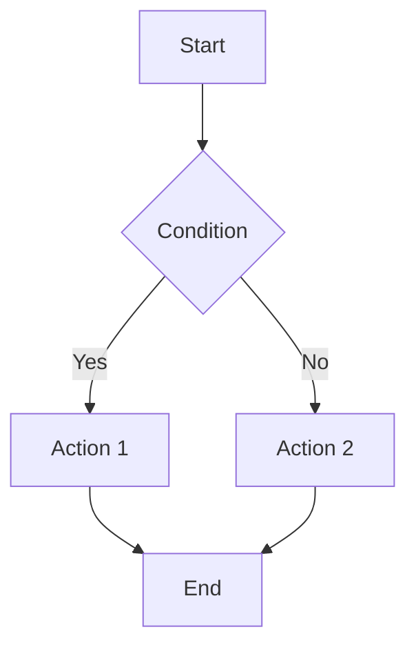

# v3-markdown-stream

English | [简体中文](./README.zh-CN.md)

[](https://npmjs.org/package/v3-markdown-stream) [](https://npmjs.org/package/v3-markdown-stream)

A high-performance Markdown streaming rendering component based on Vue 3, supporting incremental output with no flickering and no jank, with friendly styling.

[Live Demo](https://xhy12345.github.io/ "Live Demo")

> **🔧 Requirements:**
> - `@vitejs/plugin-vue` version must be **≥ 6.0.1**
> - `vite` version must be **≥ 7.2.2**
>
> Please ensure your project dependencies meet the above version requirements, otherwise compatibility issues may occur!

## Features

- ✨ **Streaming Output**: Supports incremental rendering of Markdown content, suitable for large text or streaming data scenarios
- 🎯 **Flicker-Free Rendering**: Maintains smooth transitions on every content update, improving user experience (incomplete image links, tables, and math formulas are buffered)
- 🎨 **Styling Friendly**: Built-in beautiful default styles with customizable theme color
- 🚀 **High Performance**: Optimized rendering performance using Vue's computed caching and reactivity system
- 📋 **Comprehensive Markdown Support**: Code highlighting, GFM, native HTML tags, table export, and copyable code blocks
- 🧩 **Plugin System**: Supports custom component rendering plugins, allowing you to embed custom Vue components such as ECharts charts in Markdown
- 📊 **Mermaid & ECharts**: Supports ` ```mermaid ` and ` ```echarts ` code block syntax for chart rendering, with built-in Preview/Source toggle, copy, download, zoom, and fullscreen features
- 📄 **Report Document Links**: Automatically recognizes URLs containing the `type=result` parameter in Markdown links and renders them as document cards with download buttons
- ⏳ **Fragment Loading**: Incomplete images, math formulas, plugin syntax, and Mermaid/ECharts code blocks during streaming output automatically display a loading animation
- 🛡️ **Shadow DOM Isolation**: Rendered content runs inside a Shadow DOM, so `<style>` tags in Markdown / HTML are physically isolated and will not pollute the host page's global styles

## Installation

### NPM / Yarn

```bash
npm install v3-markdown-stream
# or
yarn add v3-markdown-stream
```

## Basic Usage

### Use in a Vue Component

```vue
<template>
  <div>
    <MarkdownRender :markInfo="markdownContent" />
  </div>
</template>

<script setup>
import { ref } from 'vue'
import { MarkdownRender } from 'v3-markdown-stream';

// Static content
const markdownContent = ref('# Hello World\n\nThis is a simple markdown example.')
</script>
```

> **Styling Note**: Component styles (including KaTeX and code highlighting) are automatically injected into the Shadow Root; no need to import `dist/v3-markdown-stream.css`.

## Props

|Prop|Required|Type|Default|Description|
|-|-|-|-|-|
|markInfo|Yes|String|''|Markdown text content. You can pass the full content at once or append content incrementally for streaming|
|themeColor|No|String|'#000000'|Theme color (Strong tag font color)|
|baseFontSize|No|String|'1em'|Base font size|
|pluginRegistry|No|Object|null|Plugin registry created via `createPluginRegistry`, used to support custom component rendering|

## Events

|Event|Payload|Description|
|-|-|-|
|refClick|numbers: number[]|Triggered when a `<ref>` tag is clicked. The payload is an array of numbers extracted from `[3]` or `[1,2,3]`|

### Usage Example

```vue
<template>
  <MarkdownRender :markInfo="content" @refClick="onRefClick" />
</template>

<script setup>
const onRefClick = (numbers) => {
  console.log('Ref clicked:', numbers) // e.g. [3] or [1, 2, 3]
}
</script>
```

Usage in Markdown:

```markdown
This is a citation<ref>[3]</ref>
This is multiple citations<ref>[1,2,3]</ref>
```

## Plugin System

The plugin system allows you to embed custom Vue components in Markdown. **ECharts and Mermaid plugins are built-in**, no manual import required.

### Basic Usage

The built-in plugins support two syntaxes:

#### 1. Code Block Syntax (Recommended)

Use ` ```mermaid ` and ` ```echarts ` code blocks, with built-in Preview/Source toggle, copy, download, zoom, and fullscreen card features:

````markdown


```echarts
{
  "title": { "text": "Monthly Sales" },
  "tooltip": { "trigger": "axis" },
  "xAxis": { "type": "category", "data": ["Jan", "Feb", "Mar"] },
  "yAxis": { "type": "value" },
  "series": [{ "type": "bar", "data": [10, 20, 30] }]
}
```
````

- **ECharts**: The code block content is a complete ECharts `option` object (JSON format)
- **Mermaid**: The code block content is Mermaid syntax text
- During streaming output, Mermaid code blocks show a loading state before closing and render automatically once closed; ECharts renders when the JSON is valid and shows a loading state when invalid

#### 2. Plugin Syntax (Compatible)

Use the `[[plugin JSON config]]` syntax to render charts directly (no card wrapper):

```markdown
[[echarts {"type":"bar","data":[10,20,30,40,50]}]]

[[mermaid {"code":"graph TD\\n    A --> B"}]]
```

### ECharts Plugin

ECharts supports two usage modes:

- **Code block syntax** (recommended): The ` ```echarts ` code block content is a complete ECharts `option` object (JSON), supporting all ECharts configurations
- **Plugin syntax**: `[[echarts JSON config]]`, supports simple mode and full mode

|Config|Type|Default|Description|
|-|-|-|-|
|type|String|-|Chart type: bar, line, pie, etc. (simple mode, plugin syntax only)|
|data|Array|-|Chart data (simple mode, plugin syntax only)|
|width|String|'100%'|Chart container width (plugin syntax only)|
|height|String|'300px'|Chart container height (plugin syntax only)|
|series|Array|-|ECharts series config (full mode, mutually exclusive with type)|
|others|Any|-|All ECharts option config items can be passed in|

- **Simple mode** (plugin syntax): Pass `type` + `data`, axes and other configs are auto-completed
- **Full mode**: Pass the ECharts `option` config directly, supporting all ECharts features

### Mermaid Plugin

Mermaid supports two usage modes:

- **Code block syntax** (recommended): The ` ```mermaid ` code block content is Mermaid syntax text, supporting flowcharts, sequence diagrams, Gantt charts, etc.
- **Plugin syntax**: `[[mermaid {"code":"..."}]]`, pass Mermaid code via the `code` field

During streaming output, Mermaid code blocks show a loading state before closing and render automatically once closed, avoiding errors from invalid syntax.

### Report Document Links

When a Markdown link URL contains the `type=result` parameter, it is automatically rendered as a document card (with document icon + title + download button), no extra configuration needed:

```markdown
[AI Customer Service Platform — Requirements Doc](https://example.com/report/requirement.pdf?type=result)

[2026 Annual Tech Report](https://example.com/report/tech-2026.docx?type=result&format=docx)
```

- Automatically detects whether the URL in a standard Markdown link `[text](url)` contains the `type=result` parameter
- Renders as a rounded card with a document icon and title on the left, and a download button on the right
- Clicking the download button triggers a file download; clicking the card area opens the link in a new window

### Custom Plugins

You can create your own plugins by defining an object that conforms to the interface:

```js
import { createPluginPattern } from 'v3-markdown-stream'

const myPlugin = {
  name: 'mywidget',                          // Plugin name (for [[mywidget ...]] syntax)
  tagName: 'v3md-mywidget',                  // Custom HTML tag name
  pattern: createPluginPattern('mywidget'),  // Matching regex (or custom RegExp)
  component: MyWidgetVueComponent,           // Vue component, receives config prop
}

const registry = createPluginRegistry([myPlugin])
```

The plugin component receives the parsed JSON config object via the `config` prop:

```vue
<script setup>
const props = defineProps({
  config: {
    type: Object,
    default: () => ({})
  }
})
</script>
```

### API

#### `createPluginRegistry(plugins)`

Creates a plugin registry.

- **Parameters**: `plugins: Array<Plugin>` — array of plugins
- **Returns**: A plugin registry object to pass to the `pluginRegistry` prop of `MarkdownRender`

#### `createPluginPattern(name)`

Generates a regex matching the `[[name ...]]` syntax based on the plugin name.

- **Parameters**: `name: String` — plugin name
- **Returns**: `RegExp` — a global regular expression


[GitHub Repository](https://github.com/xhy12345/v3-markdown-stream)


If you find it useful, please give it a Star ⭐️ to support!

## Contributing

Issues and Pull Requests are welcome to help improve this component!

## License

MIT
